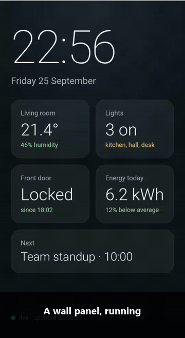
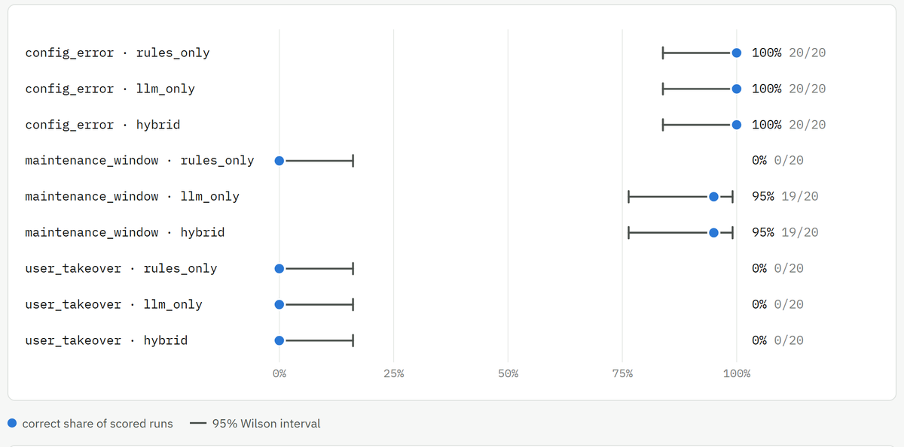
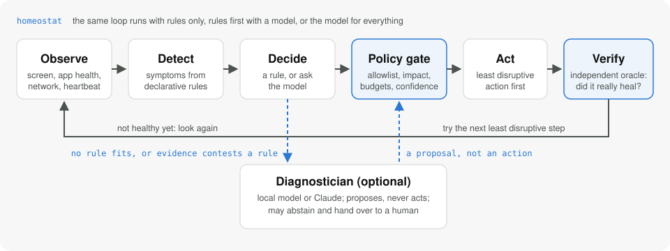

<h1 align="center">homeostat</h1>

<p align="center"><b>Where deterministic rules stop and an AI agent should start, measured on a real device.</b></p>

<p align="center">
  <a href="LICENSE"></a>
  
  
  
  
</p>

<p align="center"><a href="https://emrehangorgec.github.io/homeostat/"><b>Project site and full reports</b></a></p>

<p align="center">
  
</p>

Everyone building agents runs into the same question: **which decisions can be plain
rules, which need a model, and how do you let a model act without trusting it blindly?**
Most answers are opinions or demos. homeostat answers it with measurements.

The testbed is a real Android phone working as an always-on screen. Faults are injected
(crashes, hung apps, backend outages, expired sessions, a person picking up the phone),
and the same recovery loop is run with three decision makers: **rules only**, **rules
first with a model for what rules cannot settle**, and **the model for everything**. Every
run is checked by a verifier the decision maker never sees. 20 runs per scenario, 95%
confidence intervals, failures kept in the data.

The model is deliberately small, a free 4B model on a laptop GPU, and swappable with one
flag. The question is not how capable models are. It is what the structure around a model
does: what is left to rules, when the model is asked, what checks its proposal, and how
the result is verified.

## Findings

| | question | answer on the device |
| --- | --- | --- |
| 1 | Can rules handle faults that were anticipated? | **240 of 240**, zero unneeded disruptive actions |
| 2 | Does it matter when the model is asked? | **Yes.** Same model, **0 → 20 of 20**, by letting evidence contest a rule that fired too early |
| 3 | Does a model for everything beat rules first? | **No.** Both 65% where meaning matters (rules alone: 33%), rules first with far fewer calls |
| 4 | Can a model's confidence authorize an action? | Not here: this model's confidence did not track correctness, so the policy never uses it |
| 5 | Can model answers be turned back into rules? | Early result: 2 rules promoted by replay, 1 correctly refused (simulator and replay, no device runs yet) |

### 1. Rules are complete on the faults they were written for

Twelve fault scenarios: crashes, Android's crash dialog, another app in front, screen off,
page never loads, backend down, session expired, script error, app hung, blank screen,
Wi-Fi off, a crash during an outage.

| fault family | scenarios | correct |
| --- | --- | --- |
| app and window | 4 | 80 / 80 |
| content and network | 8 | 160 / 160 |

No model, no API key. When the backend is down the rules wait and reload; they never
restart the app, because a restart cannot fix a backend. For anticipated faults, a model
adds cost and variance and nothing else.

### 2. When the model is asked matters more than how good it is

A person picks up the device and opens another app. The right move is to leave them
alone. Every arm failed it, 0 of 20, and the reason was not the model: a rule ("another
app is in front: bring the kiosk back") fired before the model was ever consulted.

Rule packs can now declare **contests**: evidence a rule does not read that argues against
acting on it, here "someone touched the screen in the last 30 seconds". A contested rule
does not act on its own; the model is asked first, and told why.

| scenario | before | with contests |
| --- | --- | --- |
| person using the device | 0 / 20 | **20 / 20** (20 model calls) |
| another app in front, nobody touching (control) | | 20 / 20 recovered, **0 model calls** |

Nothing about the model changed. A plain rule with the same conditions as the contest
would also score 20 of 20. The useful move was not a better model but **a rule that knows
when to stop and ask**, and the control shows the model is still not called when it is
not needed.

### 3. A model helps where meaning matters, and rules first is enough

Three situations were designed so that no rule can get them right, because the right
action depends on what something means:

- a page announcing **planned maintenance** (right: wait),
- a page saying it is **not configured** (right: tell a human, touch nothing),
- a **person** picking up the phone to use another app (right: leave them alone).

<p align="center"></p>

| scenario | rules only | rules first, model when no rule fits | model for everything |
| --- | --- | --- | --- |
| planned maintenance | 0 / 20 | 19 / 20 | 19 / 20 |
| not configured | 20 / 20 | 20 / 20 | 20 / 20 |
| person using the device (see 2) | 0 / 20 | 0 / 20 | 0 / 20 |
| **correct overall** | **33%** | **65%** | **65%** |

Model: qwen3:4b, free, local, on a laptop GPU. 138 calls, median latency 27 s, cost zero.

- The model **reads the maintenance notice and waits**; rules can only escalate.
- **Rules first equals model for everything**, with far fewer model calls. The model earns
  its place only where rules have nothing to say.
- **The model reads well and labels badly.** On every "not configured" run it wrote
  "configuration error, needs admin intervention" and escalated correctly, while choosing
  the label `planned_maintenance`. Outcomes can be right for the wrong stated reason.

### 4. Confidence does not authorize actions; the policy does

For this model, stated confidence did not track correctness: about 0.95 in every
scenario, while correctness was 0.95, 1.00 and 0.00. A policy that lets a model act above
a 0.9 bar would have gained nothing from the bar. This may differ for other models, which
is why homeostat does not depend on it: every proposal passes the same deterministic
gate, and confidence never authorizes an action on its own.

### 5. Turning model answers into rules (early, not yet on the device)

If the model keeps giving the same answer in the same situation, that answer should
become a rule, and the model should stop being called. The distiller writes candidate
rules from correctly resolved incidents; each candidate is **replayed on 484 recorded
device incidents** and promoted only with at least 3 supports, zero overrides of a correct
run and at most 10% failures. Model confidence plays no part.

- **Promoted:** "maintenance notice → wait" (38 supports) and "not configured →
  escalate" (60 supports). In the simulator, model calls on those scenarios drop to zero
  with the same outcomes.
- **Refused:** the person rule. In four tries the 4B distiller dropped the 30 second
  threshold every time; replay rejected each candidate with 20 overrides, because it would
  have left the kiosk behind any app forever. **Replay, not the model, kept a bad rule out.**

Held out scenarios, drafted by a model that never sees the rules or prompts, are frozen
for the device evaluation. Those runs are next.

## What this suggests for building agents

1. **Start with rules.** Anticipated cases need no model, and rules are the baseline every
   model has to beat.
2. **Design the handoff before upgrading the model.** A rule that fires confidently in the
   wrong context cannot be fixed by the model behind it. Let evidence contest a rule and
   route it to the model.
3. **Use the model for meaning, not mechanics.** It helped exactly where the right action
   depended on reading text or intent.
4. **Gate on a deterministic policy, not on confidence:** allowed actions, least
   disruptive first, budgets and cooldowns.
5. **Verify with independent evidence.** "The command returned OK" is not "fixed".
6. **Compile what the model learns back into rules,** and validate them on recorded data,
   not on the model's word.

## Method

<p align="center"></p>

- **Observe** a normalized snapshot of the device: what is on screen, whether the app is
  alive and says it is healthy, network, battery. A value that cannot be read stays
  unknown and is never guessed.
- **Decide** with declarative rules written as data. Depending on the arm, a diagnostician
  (a local model or Claude) proposes a diagnosis, or says it is not sure.
- **Policy gate:** every proposal, from a rule or a model, passes the same checks. Only
  catalog actions, least disruptive first, budgets and cooldowns, confidence bars for
  models, never an irreversible action on a model's word alone.
- **Verify** with evidence the detector does not use: the app's UI marker, a screenshot
  that must not be blank, a stable process, a live heartbeat.
- **Score:** a run is correct when it ends in the outcome the scenario defines and nothing
  more disruptive than needed was done.

**Why a phone as the testbed:** the action space is small and known, ground truth is
checkable, and the hardware is real. It fails in ways a simulator does not (see below),
and the results are cheap to reproduce.

### What the real phone taught us

The simulator passed everything. The phone did not.

- **Android refuses to force stop a Device Owner app, silently.** `am force-stop` returns
  success and the hung app keeps running. SELinux blocks `run-as kill` too. A hung kiosk can
  only be restarted from inside the app, which is why homeostat's restart goes through the
  app's own main process.
- **A frozen app passes a naive health check.** Process up, in front, last frame on screen,
  even a cached UI tree. Only a heartbeat the app must keep publishing tells the difference.
- **The old page keeps talking during a reload.** While a new page load hung, the previous
  page kept reporting "ready" and hid the fault completely.
- **Android covers a crashing app with its own dialog.** Relaunching is not enough; the
  "app keeps stopping" dialog has to be dismissed first.
- **The lock screen comes back after sleep**, and the app is healthy behind it.
- **OxygenOS silences background apps after a minute**, so a quiet heartbeat only means
  "hung" while the app is on screen.
- **A blank page is not one exact color** (a system bar band differs by a few shades), and a
  single lost ping is not an outage.

Each of these became a signal, a rule or a fix, with a test.

### Limitations

- One device (OnePlus 5T, Android 10) and one local model (qwen3:4b). A stronger model may
  use the person signal and have meaningful confidence; that is untested.
- The scenarios that need a model were designed by the author; held out scenarios exist
  but have not been run on the device yet.
- 20 runs per cell gives wide intervals for small differences.
- Result 6 comes from replay and the simulator, not from device runs.

Full reports with every run and step by step incidents:
**[rules only, 240 runs](https://emrehangorgec.github.io/homeostat/reports/m1-device-02.html)**,
**[rules vs model, 180 runs](https://emrehangorgec.github.io/homeostat/reports/m3-device-qwen4b.html)** and
**[contested rules, 40 runs](https://emrehangorgec.github.io/homeostat/reports/m3-device-contest-qwen4b.html)**.

## Reproduce

Without a phone, against the built-in simulator:

```
python -m venv .venv
.venv/Scripts/pip install -e ".[dev]"        # .venv/bin/pip on Linux and macOS
.venv/Scripts/homeostat demo -n 20 --seed 1
```

This runs every fault scenario and prints the results table. Simulator numbers exercise
the code; they are labelled as such and never reported as device results.

<details>
<summary><b>With a phone</b></summary>

You need `adb` and a phone with USB debugging on. For the full set of recovery actions, the
homeostat agent is installed as Device Owner (see [android/README.md](android/README.md)).

```
cp config/homeostat.example.toml homeostat.toml   # target app and health marker
homeostat observe                                 # what the guardian sees right now
homeostat run                                     # guard the device
homeostat backend --reverse                       # test backend for content faults
homeostat eval app_crash backend_down -n 20       # measure recovery
homeostat report <experiment>                     # HTML report from the stored runs
```

Arms: `--arm rules_only | hybrid | llm_only`. For a free local diagnostician, install
[Ollama](https://ollama.com), `ollama pull qwen3:4b`, and pass
`--provider ollama --model qwen3:4b`. Claude is supported with `--provider claude`
(credentials from `ANTHROPIC_API_KEY` or `ant auth login`).

Model to rules and held out scenarios: `homeostat distill <experiments>`,
`homeostat adversary -n N`, `homeostat eval --scenarios FILE`.
</details>

<details>
<summary><b>Fault scenarios</b></summary>

| id | category | what happens |
| --- | --- | --- |
| `app_crash` | known | the app crashes |
| `app_killed` | variant | the app is force stopped, no crash log |
| `repeated_crash` | variant | two quick crashes; Android covers the app with its crash dialog |
| `wrong_foreground` | known | another app covers the target |
| `screen_off` | known | the display sleeps |
| `crash_then_screen_off` | composite | both at once |
| `crash_loop` | variant | the app crashes on every start |
| `blank_ui` | known | the content disappears while the app believes it is fine |
| `stuck_loading` | known | the page request hangs, content never finishes loading |
| `backend_down` | known | the backend answers 503 for 30 s: wait, do not restart |
| `auth_expired` | known | the backend invalidates sessions, the page gets 401 |
| `page_script_error` | known | the page is served with a script that throws |
| `app_hang` | variant | the main thread blocks: alive, in front, silent |
| `wifi_off` | known | Wi-Fi is switched off |
| `crash_during_outage` | composite | the app crashes while the backend is down |
| `maintenance_window` | variant | the page announces planned maintenance: wait |
| `config_error` | variant | the page says it is not configured: escalate, touch nothing |
| `user_takeover` | variant | a person opens another app and uses it: leave them alone |

Every fault states the lowest action impact that fixes it and the outcome a good guardian
reaches. A run is correct when it ends that way and nothing more disruptive was done.
</details>

<details>
<summary><b>Health contract</b></summary>

An app can tell homeostat how it is doing. The homeostat kiosk publishes one JSON line per
state change and every 5 s under the log tag `homeostat-health`:

```json
{"v":1,"state":"ready","detail":"","http":null,"age_ms":5021,"declared":true}
```

`state` is `loading`, `ready`, `error`, `auth_error` or `app_error`. A web page reports its
own state through the kiosk's JS bridge (`homeostat.declare(1)`, then
`homeostat.report(state, detail)`). Commands go the other way as package broadcasts:
`com.homeostat.contract.RELOAD`, `RESET_SESSION` and `RESTART`.
</details>

<details>
<summary><b>Writing rules</b></summary>

```toml
schema_version = "1"

[[rule]]
id = "app_not_running"
incident = "app_crash"
action = "relaunch_target"
alternatives = ["restart_target"]
priority = 30
when = [
    { path = "target_process.running", op = "eq", value = false },
    { path = "screen.awake", op = "ne", value = false },
]
```

A contest names evidence that argues against acting on a rule's match. It applies to any
rule that does not read all of its paths. With the `hybrid` arm, a contested rule asks the
model before it acts; `rules_only` ignores contests.

```toml
[[contest]]
id = "person_using_device"
when = [
    { path = "screen.last_user_activity_s", op = "lt", value = 30.0 },
    { path = "target_in_foreground", op = "eq", value = false },
    { path = "screen.awake", op = "eq", value = true },
]
```

Rules are data, so packs can be shared, and they are bound to a `DeviceState` schema
version; a pack for another version is refused at load time. Built-in rules:
[homeostat/detect/default_rules.toml](homeostat/detect/default_rules.toml).
</details>

<details>
<summary><b>Project layout</b></summary>

```
homeostat/
  state/      DeviceState schema, parsers, collector
  detect/     symptom and rule engine, built-in rule pack
  diagnose/   diagnostician contract, Claude and Ollama providers
  policy/     deterministic action gate
  act/        action catalog and executor
  verify/     healthy-state oracle
  guardian/   the recovery loop
  distill/    model answers to candidate rules, replay validation
  store/      SQLite persistence
  faults/     fault injection scenarios
  testbed/    backend that serves the kiosk page and injects server faults
  eval/       experiment runner and reports
  device/     adb transport and simulator
android/      on-device agent: Device Owner, web kiosk, health contract
```
</details>

## Open questions

- [x] Can rules alone handle anticipated faults? (240 / 240)
- [x] Where does a local model help, and where does it fail? (180 runs)
- [x] Can evidence route a confident rule to the model? (0 → 20 / 20)
- [ ] Do distilled rules hold on held out scenarios nobody tuned for? (frozen, device runs next)
- [ ] Does a stronger model use the signals a 4B model ignores, with confidence that means something?
- [ ] Do the findings carry over to other devices: Android TV boxes, Linux kiosks?

homeostat also works as a practical guardian for kiosks and wall panels, and an on-device
release is planned.

## Contributing

Device reports, captured shell output from other Android versions, rule packs, fault
scenarios and runs with other models are especially welcome. See
[CONTRIBUTING.md](CONTRIBUTING.md).

## License

[Apache License 2.0](LICENSE)
